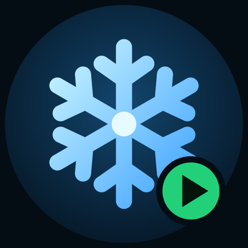
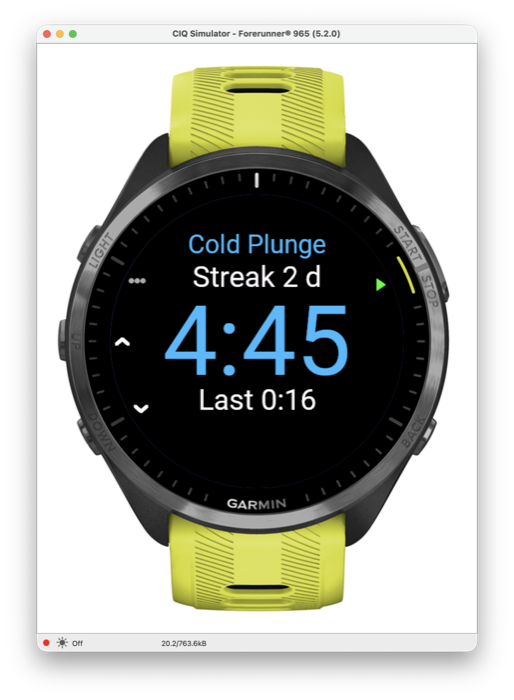
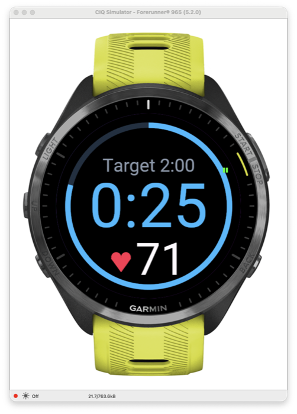
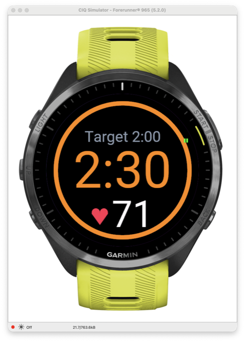
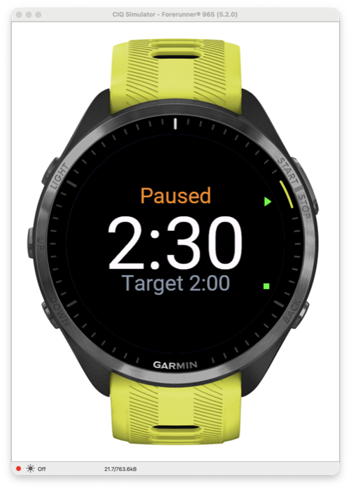
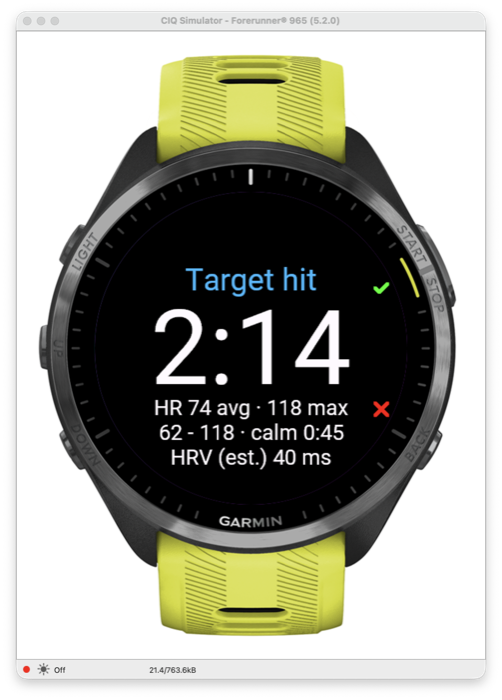

# ColdStart

ColdStart is a Garmin Connect IQ watch app that times cold showers and cold plunges and saves each one as a Garmin activity (named "Cold Shower" or "Cold Plunge") (Meditation / Breathing, falling back to Generic). It targets 53 five-button Connect IQ 5+ watches (see `manifest.xml`), developed against the Forerunner 965 simulator. Touch is ignored everywhere, so water on the screen cannot start, stop, save or discard anything.

    

**Store text:** Time your cold showers and cold plunges. Set a target, count down (then overtime), feel a pulse every 30 s and a long buzz at the target, and save each session as a Garmin activity with heart rate. Keeps a day streak and your last time. Made for wet hands: button-only, touch is ignored, so water and wet fingers can not trigger anything.

## Usage

- **Home:** the session type (Cold Shower or Cold Plunge) at the top, target time in the middle (default 2:00), the current streak above, the last saved shower below. UP/DOWN change the target in 15 s steps (0:15 to 15:00, remembered), START begins, BACK exits. **Hold UP** switches between Cold Shower and Cold Plunge (remembered; "Hold UP to switch" is written under the last time). The type is the name of the Garmin activity and is fixed once a session starts; streak and "Last" count both types together.
- **Session:** the top line always shows the target. Before the target the big number counts down; from the target on it shows the total time, still in blue (for 5 s after the target it is green). A ring shows progress and the heart rate is the large number with a heart below. The watch pulses every 30 s (300 ms), and at the target vibrates for 1 s, then 2 s later vibrates again for 1 s with a tone where the watch has a beeper. Garmin's "Do Not Disturb" can suppress app vibrations and tones, so turn it off for sessions. The backlight is kept on where supported.
- **Pause:** START during a session pauses it (short vibration): the time freezes, the Garmin activity timer stops and nothing vibrates. On the Paused screen START resumes (time continues from where it was; paused time is not counted, and a target already reached does not fire again) and BACK finishes to the summary. BACK is ignored while running.
- **Summary:** duration, target hit or missed, average and maximum heart rate, and heart rate as three columns (MIN, AVG, MAX in bpm) below. START saves the activity, BACK asks to discard (hold UP does nothing here). Showers shorter than 10 s default to discard. If the app is stopped mid-shower the session is saved as it is (discarded when under 10 s).

The activity is saved with duration and heart rate (Garmin Connect shows min, max and average HR natively) plus one custom session field, `target_s`. The Summary shows MIN, AVG and MAX heart rate in three labelled columns and hides them when no heart rate was measured.

The streak counts consecutive local calendar days with at least one saved shower; a day without a shower yet does not break a streak that ran through yesterday. Only the streak and the last duration are stored, in `Application.Storage`.

## Install (sideload)

Build a `.prg` (see CLAUDE.md) or take one from a release, connect the watch over USB and copy it to `GARMIN/APPS/` on the watch. A build is signed with the developer key, so updating an installed copy needs a build signed with the same key.

## Limitations

- Optical heart rate is unreliable under water, so heart rate in a cold plunge (and often in a shower) may be patchy or missing; the HR columns are hidden when nothing valid was measured.
- Hold UP is read as a long UP press (or the firmware's menu key); it is unverified on a physical watch.

- Heart-rate values need an optical HR reading and may be empty or noisy in water.
- Only simulator results exist so far; physical-watch checks are listed in `docs/DEVICE_TESTS.md`.
- Layouts were checked on fr965 and fr255s only.
- If the app crashes or is killed mid-shower the FIT activity is lost (it cannot be recovered). The streak day and last duration are credited from a checkpoint written every 30 s on the next launch (shown as "Recovered m:ss"), if the shower lasted at least 10 s.
- No phone sync or settings: no `Communications` permission.

## License

MIT, see `LICENSE`.
